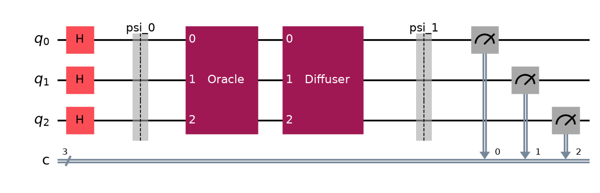
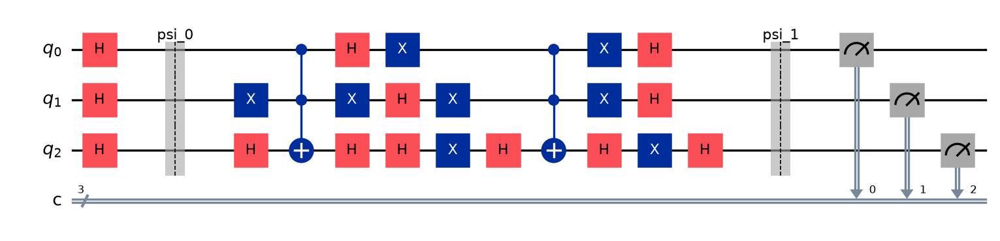
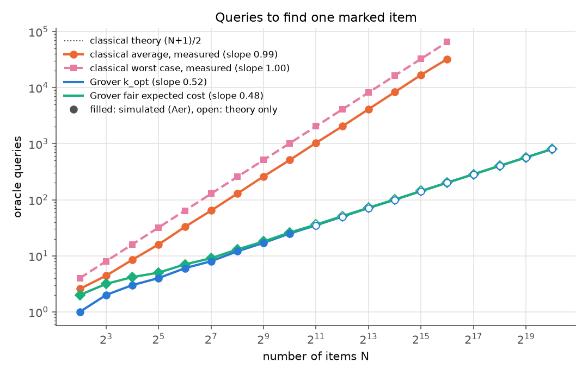
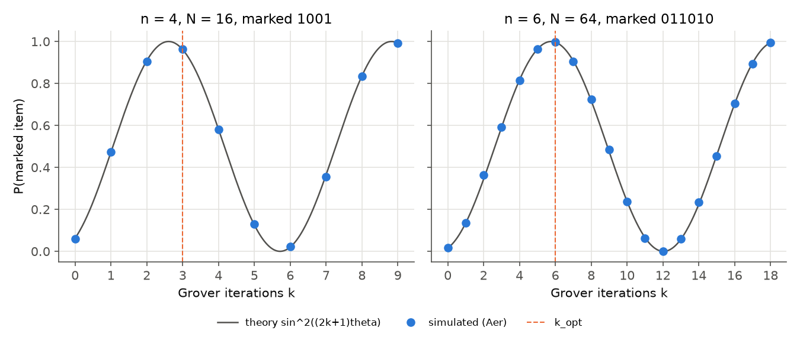
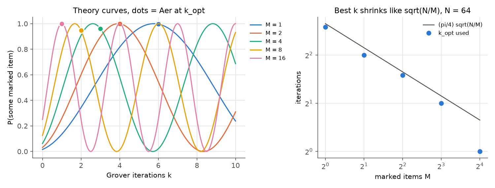
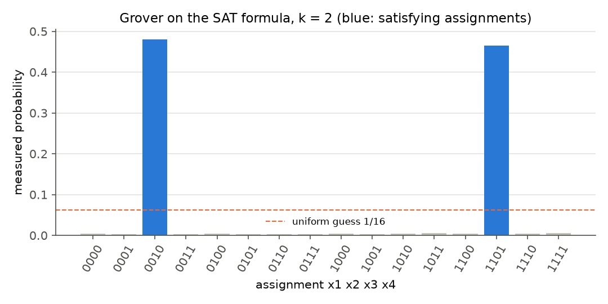
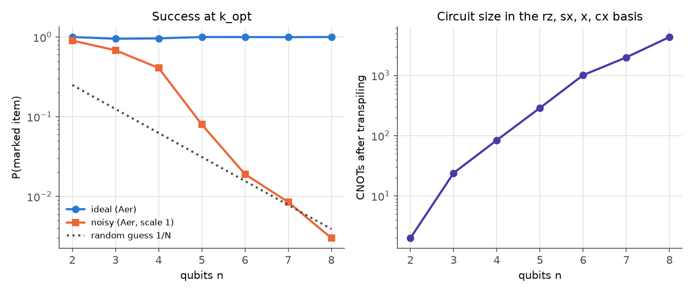
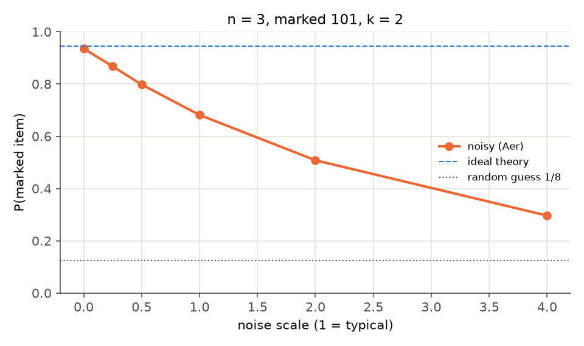
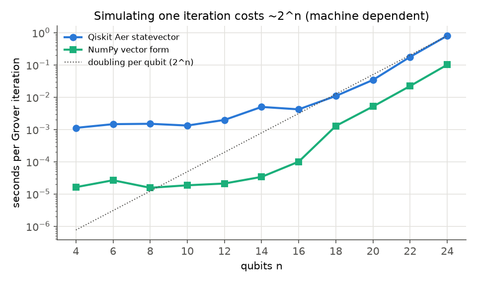

# Grover's Search: Quantum vs Classical Queries

Simulating Grover's search algorithm to show that a quantum computer can find a marked item among
N unsorted items in about sqrt(N) queries, while a classical computer needs about N/2 on average.

FQC (Foundations of Quantum Computing) course project, IIIT Sri City.

> All numbers in the tables below are written by `scripts/run_experiments.py` (fixed seeds) into
> the marked blocks of this file and into [`results/summary.md`](results/summary.md). None are typed in.

## Introduction

**The problem.** We are given a function f: {0,1}^n -> {0,1} as a black box (an oracle) with
f(x) = 1 only for the marked item(s). There are N = 2^n items, M of them marked, and no structure to
exploit, so the only way to learn about f is to query it. A classical computer checks one item per
query: in a random order that takes (N+1)/2 queries on average and N in the worst case, and no
classical algorithm does better than order N.

**The algorithm.** Notation follows the course: qubit 0 is the top wire and the leftmost bit of
every ket, the bit oracle is U_f|x>|y> = |x>|y XOR f(x)>, and with the target qubit in |-> phase
kickback turns it into the phase oracle |x> -> (-1)^f(x) |x> (lecture 08).

1. |psi_0> = H^n |0>^n = |s>, the uniform superposition over all N items.
2. Repeat k times: the oracle flips the sign of the marked items, then the diffuser
   D = 2|s><s| - I = H^n (2|0><0| - I) H^n reflects every amplitude about the mean.
3. Measure.

With sin(theta) = sqrt(M/N) the state after k iterations is
cos((2k+1) theta)|s'> + sin((2k+1) theta)|w>, where |w> is the (normalised) marked part and |s'> the
rest. Each iteration rotates the state by 2 theta towards |w>, so the success probability is
sin^2((2k+1) theta) and the best number of iterations is k_opt = floor((pi/4) sqrt(N/M)), the choice
used throughout this project.

## The circuit

n = 3, marked item `101`, one iteration. The barriers carry the course state labels: psi_0 is the
uniform superposition and psi_1 the state after one iteration.



The same circuit gate by gate: the oracle is X on qubit 1 (where `101` has a 0), a multi-controlled Z
(H, Toffoli, H on the last qubit) and X again; the diffuser is H, X, multi-controlled Z, X, H.



## Results

### 1. It works

One random marked item per n, run at k_opt. "NumPy P" is our own statevector simulator
(`grover/statevector.py`), "Aer P" is Qiskit Aer with 4000 shots. For n <= 4 every possible marked
item was also tried.

<!-- BEGIN correctness -->

| n | N | marked | k_opt | theory P | NumPy P | Aer P | top result correct | every item found (n <= 4) |
|---|---|---|---|---|---|---|---|---|
| 2 | 4 | `11` | 1 | 1.0000 | 1.0000 | 1.000 | yes | yes (min P 1.000) |
| 3 | 8 | `101` | 2 | 0.9453 | 0.9453 | 0.951 | yes | yes (min P 0.936) |
| 4 | 16 | `1010` | 3 | 0.9613 | 0.9613 | 0.961 | yes | yes (min P 0.955) |
| 5 | 32 | `11100` | 4 | 0.9992 | 0.9992 | 1.000 | yes | - |
| 6 | 64 | `100101` | 6 | 0.9966 | 0.9966 | 0.998 | yes | - |
| 7 | 128 | `1100011` | 8 | 0.9956 | 0.9956 | 0.996 | yes | - |
| 8 | 256 | `11010101` | 12 | 0.9999 | 0.9999 | 1.000 | yes | - |
| 9 | 512 | `001110011` | 17 | 0.9994 | 0.9994 | 1.000 | yes | - |
| 10 | 1024 | `0000111000` | 25 | 0.9995 | 0.9995 | 0.999 | yes | - |

<!-- END correctness -->

The most likely result is the marked item for every n, and both simulators agree with
sin^2((2k+1) theta). Our NumPy simulator also matches `qiskit.quantum_info.Statevector` to a fidelity
of at least 1 - 1e-9 in the tests.

### 2. The advantage: queries vs N

Classical queries are counted with a `QueryCounter` wrapped around the same oracle truth table the
quantum circuit uses. Grover's oracle calls are counted from the circuit (the number of oracle
blocks). Filled markers are simulated with Aer; open markers (large N) use k_opt and the theory
success probability, since the query count needs no simulation.



<!-- BEGIN slopes -->

Fitted log-log slopes (queries ~ N^slope), classical for n = 2..16 with 500 searches per n, Grover for n = 2..20:

| quantity | slope |
|---|---|
| classical average queries (measured) | 0.987 |
| classical worst case (measured) | 1.000 |
| Grover k_opt (oracle calls) | 0.517 |
| Grover fair expected cost | 0.479 |

<!-- END slopes -->

On log-log axes a power law N^a is a straight line with slope a. Theory predicts slope 1 for the
classical search and 1/2 for Grover, and the fitted slopes are close to both. The floor in k_opt makes the smallest-N points
ragged, which moves the fitted Grover slopes slightly away from exactly 1/2.

### 3. A fair count

Grover succeeds with probability P < 1. A fair cost repeats it until it succeeds and checks each
candidate with one classical query, so the expected number of queries is (k_opt + 1) / P. The
classical side also stops only when its query confirms the item. If you know there is exactly one
marked item you can skip the last classical query, which lowers the classical worst case to N - 1
and changes nothing in the comparison.

<!-- BEGIN fair -->

| n | N | classical expected (N+1)/2 | classical measured avg | classical measured worst | Grover k_opt | Grover P | Grover fair cost (k+1)/P | speedup | Grover P from |
|---|---|---|---|---|---|---|---|---|---|
| 2 | 4 | 2.5 | 2.6 | 4 | 1 | 1.0000 | 2.00 | 1.2 | Aer |
| 4 | 16 | 8.5 | 8.5 | 16 | 3 | 0.9605 | 4.16 | 2.0 | Aer |
| 6 | 64 | 32.5 | 32.8 | 64 | 6 | 0.9980 | 7.01 | 4.6 | Aer |
| 8 | 256 | 128.5 | 128.8 | 256 | 12 | 0.9998 | 13.00 | 9.9 | Aer |
| 10 | 1024 | 512.5 | 512.1 | 1019 | 25 | 0.9985 | 26.04 | 19.7 | Aer |
| 12 | 4096 | 2048.5 | 2040.5 | 4093 | 50 | 0.9999 | 51.00 | 40.2 | theory |
| 14 | 16384 | 8192.5 | 8331.5 | 16384 | 100 | 1.0000 | 101.00 | 81.1 | theory |
| 16 | 65536 | 32768.5 | 32370.3 | 65331 | 201 | 1.0000 | 202.00 | 162.2 | theory |
| 18 | 262144 | 131072.5 | - | - | 402 | 1.0000 | 403.00 | 325.2 | theory |
| 20 | 1048576 | 524288.5 | - | - | 804 | 1.0000 | 805.00 | 651.3 | theory |

<!-- END fair -->

The speedup column grows like sqrt(N): every two extra qubits multiply N by 4, which multiplies
the classical cost by 4 but Grover's only by 2. The advantage is **quadratic, not exponential**. Unstructured search has no
structure for an exponential speedup to exploit, and Grover is provably optimal: no quantum algorithm
can use fewer than order sqrt(N) queries.

### 4. Iterations matter



<!-- BEGIN iterations -->

| n | k_opt | Aer P at k_opt | 2 k_opt | Aer P at 2 k_opt | 3 k_opt | Aer P at 3 k_opt | largest gap between Aer and theory over all k |
|---|---|---|---|---|---|---|---|
| 4 | 3 | 0.964 | 6 | 0.022 | 9 | 0.993 | 0.010 |
| 6 | 6 | 0.998 | 12 | 0.000 | 18 | 0.995 | 0.021 |

<!-- END iterations -->

The success probability oscillates exactly as sin^2((2k+1) theta) predicts. At 2 k_opt the state
has rotated past |w> to almost nothing: too many iterations is as bad as too few.

### 5. More than one answer

n = 6 (N = 64) with M marked items chosen at random.



<!-- BEGIN multi -->

| M | (pi/4) sqrt(N/M) | k_opt | theory P | Aer P | classical expected (N+1)/(M+1) |
|---|---|---|---|---|---|
| 1 | 6.28 | 6 | 0.9966 | 0.997 | 32.50 |
| 2 | 4.44 | 4 | 0.9992 | 1.000 | 21.67 |
| 4 | 3.14 | 3 | 0.9613 | 0.961 | 13.00 |
| 8 | 2.22 | 2 | 0.9453 | 0.949 | 7.22 |
| 16 | 1.57 | 1 | 1.0000 | 1.000 | 3.82 |

<!-- END multi -->

More marked items make theta larger and the rotation faster, so the best number of iterations shrinks
like sqrt(N/M) (Boyer, Brassard, Hoyer and Tapp).

### 6. A real search problem: SAT

The usual objection to Grover demos is that "the oracle already knows the answer". Here it does not.
The SAT oracle (`grover/oracles.py`, `sat_oracle`) evaluates a CNF formula clause by clause: each
clause ancilla is set to the OR of its literals with X gates and a multi-controlled X, a final
multi-controlled X from all clause ancillas onto a |-> qubit kicks back the phase (-1)^f(x), and the
ancillas are uncomputed. The circuit is built from the clauses alone; the solutions are found by
brute force only to check the result (and the tests check every input and that the ancillas return to 0).

<!-- BEGIN sat -->

- Formula: `(x1 OR x2 OR x3) AND (NOT x1 OR NOT x3) AND (x1 OR NOT x2) AND (x3 OR x4) AND (x2 OR NOT x4)`
- Satisfying assignments by brute force (x1 x2 x3 x4): `0010`, `1101`
- Circuit: 4 variable qubits, 5 clause ancillas, 1 output qubit in |->, 10 qubits in total
- Grover with M = 2, N = 16: k_opt = 2, theory P = 0.9453, Aer P = 0.946
- Three most frequent results: `0010` (0.480), `1101` (0.465), `1011` (0.006)

<!-- END sat -->



Grover amplifies exactly the satisfying assignments, without ever being told what they are.

### 7. Noise

Real hardware has no multi-controlled gates. Each noisy circuit is transpiled to the basis
`rz, sx, x, cx` (optimization level 1, fixed seed) and run with a noise model that puts depolarizing
error on every one of those gates (p1 = 0.001 on `rz, sx, x`, p2 = 0.01 on `cx`) plus readout error
(P(1|0) = 0.02, P(0|1) = 0.04), all multiplied by a noise scale. A test checks that every gate in
every transpiled circuit has an error attached, and `run_grover` refuses to run if one does not, so
no gate runs noiseless by accident.



<!-- BEGIN noise_n -->

| n | N | k_opt | ideal P (Aer) | noisy P (Aer) | random guess 1/N | CNOTs after transpile |
|---|---|---|---|---|---|---|
| 2 | 4 | 1 | 1.000 | 0.902 | 0.250 | 2 |
| 3 | 8 | 2 | 0.951 | 0.682 | 0.125 | 24 |
| 4 | 16 | 3 | 0.961 | 0.409 | 0.062 | 84 |
| 5 | 32 | 4 | 1.000 | 0.080 | 0.031 | 288 |
| 6 | 64 | 6 | 0.998 | 0.019 | 0.016 | 1008 |
| 7 | 128 | 8 | 0.996 | 0.009 | 0.008 | 1984 |
| 8 | 256 | 12 | 1.000 | 0.003 | 0.004 | 4320 |

From n = 6 on (1008 CNOTs) the noisy success probability is below twice the random-guess level 1/N.

<!-- END noise_n -->



<!-- BEGIN noise_level -->

n = 3, marked `101`, k = 2, ideal theory P = 0.9453, 24 CNOTs after transpiling.

| noise scale | P(marked item) |
|---|---|
| 0 | 0.936 |
| 0.25 | 0.868 |
| 0.5 | 0.798 |
| 1 | 0.682 |
| 2 | 0.508 |
| 4 | 0.296 |

<!-- END noise_level -->

**Finding.** The ideal algorithm works at every n, but after transpiling the multi-controlled gates
become a rapidly growing number of CNOTs (table above), and with typical error rates the success rate collapses
towards random guessing (1/N) within a few qubits. Even for n = 3 the success probability falls steadily
as the noise grows. Grover's advantage at scale needs error-corrected hardware.

### 8. Why simulation is not a speedup



A classical simulator keeps all 2^n amplitudes, so even one Grover iteration costs time proportional
to 2^n once n is large enough for the fixed overheads to stop mattering, and a full run needs about
sqrt(2^n) iterations on top. The timings are machine dependent and are listed in the last section of
[`results/summary.md`](results/summary.md). The simulation is a classical computation: the quantum
advantage is counted in **oracle queries**, not in seconds on a laptop.

## Conclusion

- **What the advantage is.** Grover finds a marked item among N unsorted items with about
  (pi/4) sqrt(N/M) oracle queries, against about N/2 for classical search. Counting real oracle calls,
  the fitted log-log slopes are close to 1/2 and 1.
- **What it is not.** It is a quadratic speedup in queries, not an exponential one, even after paying
  for repeats and checks. It also does not make classical simulation of the algorithm fast.
- **What matters in practice.** The number of iterations must be chosen from N and M, because the
  success probability oscillates. The oracle can be a genuine checker, as in the SAT example.
- **What noise does.** The multi-controlled gates turn into large numbers of CNOTs, and on a realistic
  noise model the success rate drops to the random-guess level after a few qubits.

## How to install and run (PowerShell)

Requires Python 3.11 to 3.13 (developed on 3.13). From the repository root:

```powershell
py -3.13 -m venv .venv
.\.venv\Scripts\Activate.ps1
python -m pip install --upgrade pip
python -m pip install -r requirements.txt
```

If PowerShell blocks `Activate.ps1`, allow scripts for this session only and activate again:

```powershell
Set-ExecutionPolicy -Scope Process -ExecutionPolicy Bypass
.\.venv\Scripts\Activate.ps1
```

Run the tests, regenerate every figure, `results/summary.md` and the tables in this README, and
re-execute the notebook:

```powershell
python -m pytest
python scripts\run_experiments.py
python -m jupyter nbconvert --to notebook --execute --inplace notebooks\grover.ipynb
```

Open the notebook interactively:

```powershell
python -m jupyter notebook notebooks\grover.ipynb
```

## Project structure

```
grover/
  oracles.py        marked-string oracle, multiple marked items, SAT oracle (each with its truth table)
  circuits.py       diffuser, Grover circuit with psi_k barriers, k_opt, theory formulas
  quantum.py        run on Aer (ideal or noisy), course bit order, oracle calls counted from the circuit
  classical.py      random-order classical search with a query counter, expected-cost formulas
  statevector.py    small NumPy simulator (gate level and vector form) used to cross-check Qiskit
  noise.py          transpile settings and the matching Aer noise model
tests/              pytest suite (bit order, oracles, diffuser, simulators, classical, noise)
scripts/
  run_experiments.py  regenerates results/figures, results/summary.md and the README tables
notebooks/
  grover.ipynb      step-by-step walkthrough, committed with outputs
results/
  figures/          all figures
  summary.md        all result tables
requirements.txt
```

## References

1. V. Pulabaigari, FQC lecture slides, IIIT Sri City (course introduction, Deutsch's problem,
   Deutsch-Jozsa), for notation: oracles, phase kickback and Hadamard transforms.
2. L. K. Grover, "A fast quantum mechanical algorithm for database search", Proceedings of the 28th
   ACM Symposium on Theory of Computing (STOC), 1996, pp. 212-219.
3. M. A. Nielsen and I. L. Chuang, *Quantum Computation and Quantum Information*, Cambridge
   University Press, section 6.1 (the quantum search algorithm).
4. M. Boyer, G. Brassard, P. Hoyer and A. Tapp, "Tight bounds on quantum searching", Fortschritte
   der Physik 46 (1998), pp. 493-505 (multiple solutions).
5. Qiskit and Qiskit Aer documentation, https://quantum.cloud.ibm.com/docs (circuits, transpiler,
   noise models).
